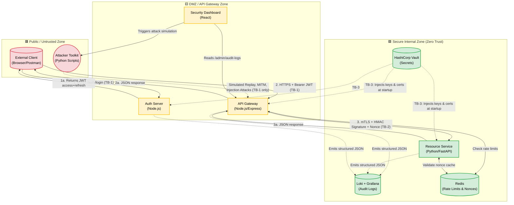

# System Architecture & Trust Boundaries

## Legend
- 🟥 **Red zone** — Untrusted / public internet
- 🟨 **Yellow zone (DMZ)** — Internet-facing, semi-trusted, TLS-terminated
- 🟩 **Green zone** — Internal only, zero-trust (mTLS required), never internet-reachable
- **Solid arrows** — synchronous request/response traffic
- **Dashed arrows** — async / startup-time / observability traffic
- **TB-1 / TB-2 / TB-3** — trust boundary crossings, matching `threat-model.md` Section 3

## Key Design Property (say this out loud in interviews)
The Attacker node has **exactly one edge** in this diagram — into the Gateway. It cannot reach the Resource Service, Vault, Redis, or Logs directly, no matter what it sends. That single-entry-point property is the whole point of the DMZ pattern: even a fully successful attack at TB-1 still has to get through TB-2 (mTLS + HMAC + nonce + independent scope check) before touching real data. If your diagram ever grows a second arrow from Attacker into the green zone, that's a design flaw to catch before writing code, not after.

## Data Flow Summary (numbered, matches diagram labels)
1. Client authenticates → Auth Server issues short-lived JWT (access) + refresh token.
2. Client calls Gateway over HTTPS with `Authorization: Bearer <JWT>`.
3. Gateway validates JWT, checks Redis for rate-limit status, then signs the downstream request (HMAC + nonce + timestamp) and calls Resource Service over mTLS.
4. Resource Service verifies the mTLS client cert, HMAC signature, nonce (via Redis), timestamp window, and scope — independently of the Gateway's own checks — before touching data.
5. Response flows back Resource → Gateway → Client.
6. Every service emits structured logs to Loki/Grafana continuously; Vault injects secrets once at startup (not per-request).
